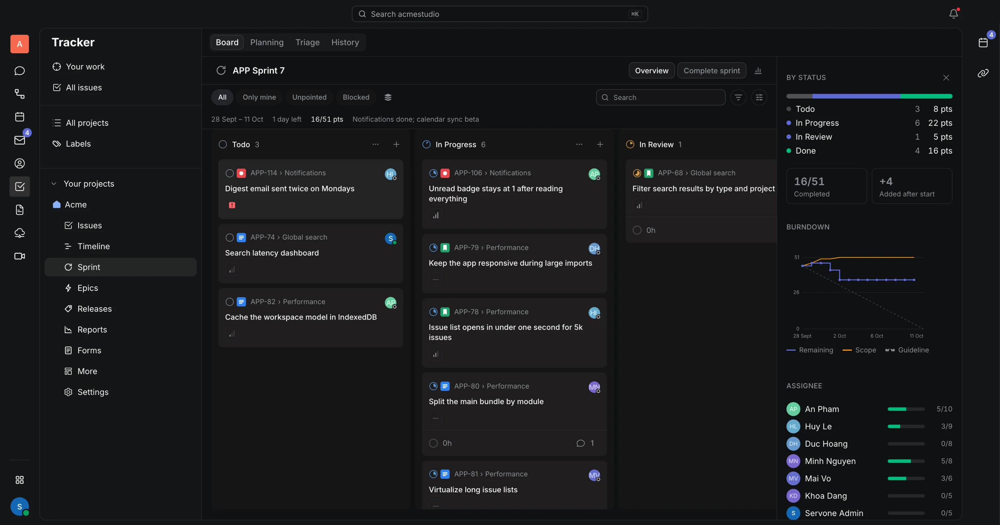
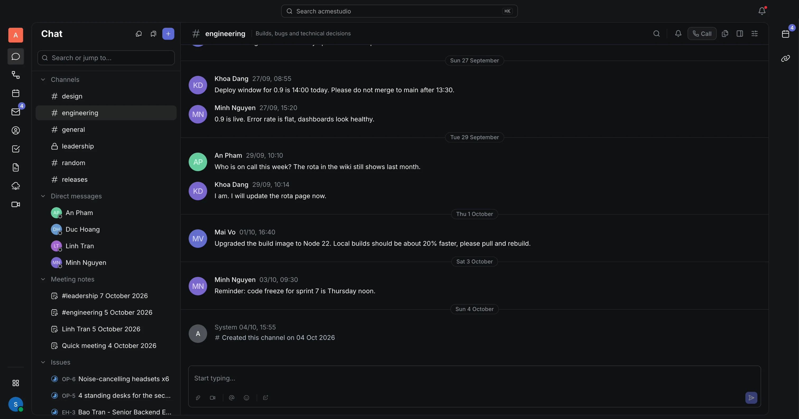
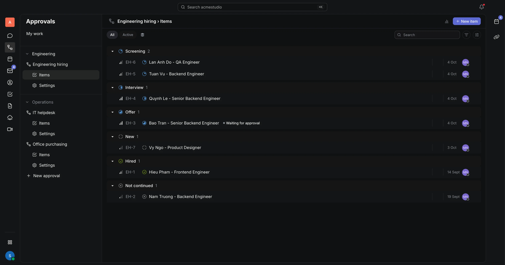
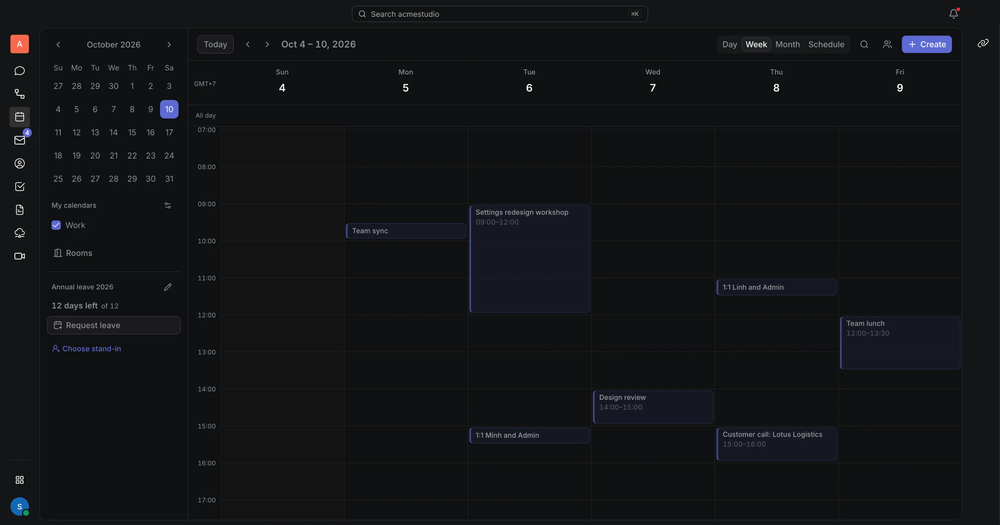
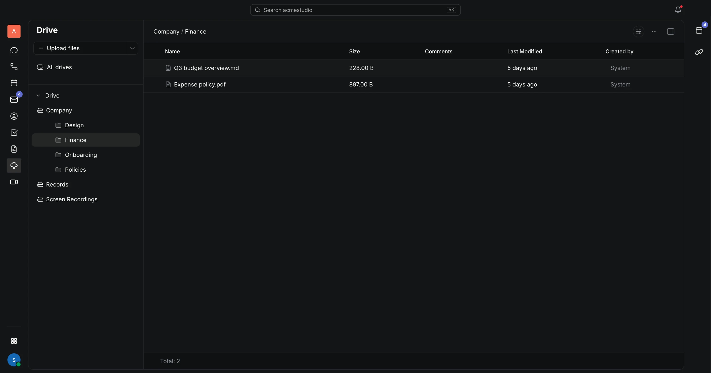

<div align="center">

<a href="https://www.servone.app"></a>

# Servone

**One workspace for a small team's daily work.**<br>
Issues and sprints, chat, calendar and meetings, documents and files, approvals and forms, in one app, in English and Vietnamese.

[Website](https://www.servone.app) · [Documentation](https://www.servone.app/docs) · [Get started](https://www.servone.app/docs/get-started) · [FAQ](https://www.servone.app/docs/reference/faq)

[](LICENSE)
[](https://www.servone.app/docs)
[](https://github.com/hcengineering/platform)

<br>



</div>

## About

Small teams usually pay for a task tracker, a chat app, a calendar, a shared drive and an approval tool, then spend their day copying links between them. Servone puts them in one workspace that shares the same people, permissions, search and notifications, so a chat message becomes an issue, an issue links to a document, and a meeting lands on everyone's calendar without leaving the app.

Servone is built on the [Huly Platform](https://github.com/hcengineering/platform) by Hardcore Engineering and adds its own interface, backend and apps on top. The hosted version runs at [www.servone.app](https://www.servone.app).

## Inside the workspace

<table>
  <tr>
    <td width="50%" valign="top">
      <a href="https://www.servone.app/docs/chat"></a>
      <h3><a href="https://www.servone.app/docs/chat">Chat</a></h3>
      Channels, threads and direct messages, plus forwarding, reminders, your own sidebar sections and Slack-style shortcuts. Turn any message into an issue.
    </td>
    <td width="50%" valign="top">
      <a href="https://www.servone.app/docs/approvals"></a>
      <h3><a href="https://www.servone.app/docs/approvals">Approvals and workflows</a></h3>
      Hiring, purchasing, contracts, IT requests and onboarding, each with its own steps, approvers, intake form and SLA.
    </td>
  </tr>
  <tr>
    <td width="50%" valign="top">
      <a href="https://www.servone.app/docs/calendar"></a>
      <h3><a href="https://www.servone.app/docs/calendar">Calendar and meetings</a></h3>
      One agenda for events, deadlines and leave, with room and resource booking. Meetings start from an event or a chat and keep their minutes.
    </td>
    <td width="50%" valign="top">
      <a href="https://www.servone.app/docs/drive"></a>
      <h3><a href="https://www.servone.app/docs/drive">Documents and drive</a></h3>
      Collaborative documents in teamspaces and a shared drive for files, all covered by the same search.
    </td>
  </tr>
</table>

## Features

| | |
| --- | --- |
| **[Tracker](https://www.servone.app/docs/tracker)** | Classic and Scrum projects, sprints, backlog, epics, timeline, burndown and velocity reports, project insights, custom statuses and issue forms |
| **[Chat](https://www.servone.app/docs/chat)** | Channels, threads and direct messages, with message forwarding, remind-me-later, custom sidebar sections, search filtered by person, place and file, Slack-style shortcuts and quick switcher, announcement channels, department channels that members join automatically, guest access, a message-to-issue action, and incoming and outgoing webhooks |
| **[Calendar](https://www.servone.app/docs/calendar)** | A rebuilt calendar with day, 3-day, week, month and schedule views, colleagues' calendars side by side, calendar sharing, rooms and resources, leave requests, Google Calendar sync |
| **[Meetings](https://www.servone.app/docs/meetings)** | Video calls started from an event or a chat, Meet now for a quick call, guests by link, live call status in the channel, and meeting notes |
| **[Documents](https://www.servone.app/docs/documents) and [Drive](https://www.servone.app/docs/drive)** | Real-time collaborative documents and shared files, with Save to Drive for chat attachments |
| **[Approvals](https://www.servone.app/docs/approvals)** | Department workflows with approval steps, intake forms, SLAs and templates |
| **[People](https://www.servone.app/docs/people/directory)** | Employee directory, org chart, departments with their own channels, CSV import |
| **[Import](https://www.servone.app/docs/admin/import)** | Tasks, documents and people from ClickUp, Jira, Linear, Asana, Trello, Monday, Notion, Confluence, Google Docs, Slack, Discord and Microsoft Teams |
| **[AI clients](https://www.servone.app/docs/integrations/mcp)** | A built-in MCP server, so Claude, Cursor and other AI clients can read and update the workspace with your permissions |
| **Search and inbox** | A command palette for search and quick actions, and an inbox that groups notifications and pending approvals |
| **API** | An issues REST API, API tokens and signed outgoing webhooks |

## Connect an AI client

Servone runs an [MCP](https://modelcontextprotocol.io) server next to the app. Add it as a custom connector in Claude, Cursor or any MCP client, sign in with your Servone account, and the client can search the workspace, create and update issues, post messages and read calendars, limited to what your account is allowed to do. Setup steps are in the [MCP guide](https://www.servone.app/docs/integrations/mcp).

## Run it locally

You need Node.js 22 (see `.nvmrc`), [Rush](https://rushjs.io), Docker with Compose, and about 8 GB of free memory for the dev server.

```bash
nvm use
npm install -g @microsoft/rush
rush install
rush build
```

Then start the backend and the front end:

```bash
dev/servone-stack.sh up       # backend containers; reads DB_CR_URL from dev/.env.servone-cloud
dev/servone-front.sh local    # webpack dev server against that stack
```

`dev/servone-stack.sh` expects a CockroachDB connection string in `DB_CR_URL`. The Huly stack in [dev/docker-compose.yaml](dev/docker-compose.yaml) with a local `cockroach` container works as well.

Run the tests with `rush test` for every package, or `rushx test` inside one package. Desktop builds (`rushx dist` in `desktop-package`) need `DESKTOP_APP_ID`, a reverse-DNS app id such as `app.servone.desktop`.

Building the Docker images, UI tests, Windows and WSL setup and troubleshooting work as they do upstream; see the [Huly Platform README](https://github.com/hcengineering/platform#readme).

<details>
<summary><b>Repository layout</b></summary>

<br>

| Path | Contents |
| --- | --- |
| `packages/servone-ui` | The Servone front end, loaded over the Huly plugins |
| `packages/servone-theme` | CSS variables and the Tailwind pipeline behind the Servone components |
| `packages/servone-approvals` | Approval rules, also enforced inside the transactor |
| `packages/servone-config`, `servone-forms`, `servone-import`, `servone-mail`, `servone-notify-rules` | Shared libraries used by the front end and the backend |
| `services/servone` | The backend: MCP server, issues API, webhooks, workflows, imports, starter content |
| `dev/servone-*` | Local stack scripts, seed data and maintenance scripts |
| `dev/railway` | The Railway deploy config used for servone.app |
| `tests/servone` | Playwright end-to-end tests |

</details>

## Built on Huly

Servone is a fork of the [Huly Platform](https://github.com/hcengineering/platform). Huly provides the data model, the real-time transactor, the account service and most of the plugins. Servone keeps its own work in separate packages and keeps edits inside Huly's files small, so upstream changes can still be merged in.

- Servone's own code lives in `packages/servone-*`, `services/servone`, `dev/servone-*`, `dev/railway` and `tests/servone`.
- Every change made inside an upstream Huly file is listed in [docs/upstream-edits.md](docs/upstream-edits.md).
- [NOTICE](NOTICE) records the upstream commit this tree is synced with.

Thank you to the Huly team and every contributor to the platform.

## Contributing

Issues and pull requests are welcome. Read [CONTRIBUTING.md](CONTRIBUTING.md) for setup, where code goes and how to send a change, and the [Code of Conduct](CODE_OF_CONDUCT.md). Questions go to [Discussions](https://github.com/Trox824/servone/discussions).

Report security problems privately as described in [SECURITY.md](SECURITY.md). If the problem is in unmodified Huly code, report it to [Huly](https://github.com/hcengineering/platform/security) as well.

## License

Servone is licensed under the [Eclipse Public License 2.0](LICENSE), the same license as Huly.
